# G4 Real Estate Property Listings Portal

**Course:** SE1020 — Object-Oriented Programming  
**Group:** G4 | **University:** SLIIT

---

## Project Overview

A full-stack web application for listing, searching, booking, and reviewing real estate properties. Buyers and sellers can register, list properties, make inquiries, submit bookings, process simulated payments, and leave reviews. Admins manage categories and oversee the platform.

---

## Technology Stack

| Layer | Technology |
|-------|-----------|
| Backend | Java 21, Spring Boot 3.3.4, Maven |
| Frontend | React 18, Vite 5, JSX, CSS |
| Storage | Plain text files (pipe-delimited) in `backend/data/` |
| Security | BCrypt passwords, JWT authentication |
| API style | REST — JSON over HTTP |

---

## Folder Structure

```
REAL ESTATE PROJECT/
├── backend/
│   ├── data/                          ← Text file storage (auto-created)
│   │   ├── users.txt
│   │   ├── properties.txt
│   │   ├── bookings.txt
│   │   ├── payments.txt
│   │   ├── inquiries.txt
│   │   ├── categories.txt
│   │   └── reviews.txt
│   ├── src/main/java/com/realestate/portal/
│   │   ├── config/                    ← CorsConfig, AuthInterceptor, DataInitializer
│   │   ├── controller/                ← REST controllers (9 files)
│   │   ├── dto/                       ← Data Transfer Objects (20 files)
│   │   ├── exception/                 ← Custom exceptions + GlobalExceptionHandler
│   │   ├── model/                     ← Domain entities (14 files)
│   │   ├── repository/                ← File repositories (9 files)
│   │   ├── service/                   ← Service interfaces + impls (16 files)
│   │   │   └── payment/               ← Strategy pattern processors (4 files)
│   │   └── util/                      ← Helpers: JWT, BCrypt, IDs, FileTextUtil
│   └── pom.xml
└── frontend/
    ├── src/
    │   ├── api/                       ← API client modules (7 files)
    │   ├── components/                ← Shared UI components
    │   │   ├── Navbar/
    │   │   ├── Footer/
    │   │   ├── LoadingSpinner/
    │   │   ├── EmptyState/
    │   │   ├── Modal/
    │   │   └── ProtectedRoute/
    │   ├── context/                   ← AuthContext, ToastContext
    │   ├── pages/
    │   │   ├── Home/
    │   │   ├── Member1_User/          ← Register, Login, Profile, EditProfile
    │   │   ├── Member2_Property/      ← PropertyList, Details, Add, Edit, MyProperties
    │   │   ├── Member3_BookingPayment/← CreateBooking, MyBookings, ManageBookings, Payment, Receipt...
    │   │   ├── Member4_Inquiry/       ← Submit, MyInquiries, Edit, SellerManagement
    │   │   ├── Member5_AdminCategory/ ← AdminDashboard, CategoryList, AddCategory, EditCategory
    │   │   └── Member6_Review/        ← AddReview, PropertyReviews, MyReviews, EditReview
    │   ├── App.jsx
    │   ├── App.css
    │   ├── main.jsx
    │   └── index.css
    ├── index.html
    ├── vite.config.js
    └── package.json
```

---

## Setup & Run Instructions

### Prerequisites

| Tool | Version | Notes |
|------|---------|-------|
| JDK | 21 | `C:\Program Files\Java\jdk-21` |
| Maven | 3.9.9 | `C:\Users\skfam\maven\apache-maven-3.9.9` |
| Node.js | ≥ 18 | `C:\Program Files\nodejs` |

---

### 1. Start the Backend

Open PowerShell and run:

```powershell
cd "c:\Users\skfam\OneDrive\Desktop\REAL ESTATE PROJECT\backend"
$env:JAVA_HOME = "C:\Program Files\Java\jdk-21"
& "C:\Users\skfam\maven\apache-maven-3.9.9\bin\mvn.cmd" spring-boot:run
```

The backend starts on **http://localhost:8080**.  
Data files are auto-created in `backend/data/` on first run with sample data.

---

### 2. Start the Frontend

Open a **second** PowerShell window:

```powershell
cd "c:\Users\skfam\OneDrive\Desktop\REAL ESTATE PROJECT\frontend"
$env:Path = "C:\Program Files\nodejs;" + $env:Path
& "C:\Program Files\nodejs\npm.cmd" run dev
```

The frontend starts on **http://localhost:5173**.

---

### Sample Login Credentials

| Role | Email | Password |
|------|-------|---------|
| Admin | admin@realestate.com | Admin@123 |
| Seller | seller1@realestate.com | Seller@123 |
| Seller | seller2@realestate.com | Seller@123 |
| Buyer | buyer1@realestate.com | Buyer@123 |
| Buyer | buyer2@realestate.com | Buyer@123 |

> Passwords are hashed with BCrypt in `users.txt`. Never stored in plain text.

---

## Member CRUD Matrix

| Member | Domain | Create | Read | Update | Delete | Data File |
|--------|--------|--------|------|--------|--------|-----------|
| 1 | User Management | POST /api/auth/register | GET /api/users/profile | PUT /api/users/profile | DELETE /api/users/:id | users.txt |
| 2 | Property Listings | POST /api/properties | GET /api/properties | PUT /api/properties/:id | DELETE /api/properties/:id | properties.txt |
| 3 | Booking & Payment | POST /api/bookings, POST /api/payments | GET /api/bookings/my-bookings, GET /api/payments/my-payments | PUT /api/bookings/:id/status | DELETE /api/bookings/:id, DELETE /api/payments/:id | bookings.txt, payments.txt |
| 4 | Inquiries | POST /api/inquiries | GET /api/inquiries/my-inquiries | PUT /api/inquiries/:id | DELETE /api/inquiries/:id | inquiries.txt |
| 5 | Admin & Categories | POST /api/categories | GET /api/categories | PUT /api/categories/:id | DELETE /api/categories/:id | categories.txt |
| 6 | Reviews | POST /api/reviews | GET /api/reviews/property/:id | PUT /api/reviews/:id | DELETE /api/reviews/:id | reviews.txt |

---

## API Endpoint Reference

### Authentication (Member 1)
| Method | Endpoint | Auth | Description |
|--------|----------|------|-------------|
| POST | /api/auth/register | None | Register buyer or seller |
| POST | /api/auth/login | None | Login and receive JWT |

### Users (Member 1)
| Method | Endpoint | Auth | Description |
|--------|----------|------|-------------|
| GET | /api/users/profile | Any | Get own profile |
| PUT | /api/users/profile | Any | Update own profile |
| PUT | /api/users/change-password | Any | Change password |
| GET | /api/users/:id | Any | Get user by ID |
| GET | /api/users | ADMIN | List all users |
| DELETE | /api/users/:id | ADMIN or self | Delete account |

### Properties (Member 2)
| Method | Endpoint | Auth | Description |
|--------|----------|------|-------------|
| GET | /api/properties | None | Browse all properties (supports ?keyword, ?type, ?categoryId, ?minPrice, ?maxPrice, ?location) |
| GET | /api/properties/:id | None | Get property details |
| POST | /api/properties | SELLER | Create property listing |
| PUT | /api/properties/:id | SELLER (owner) | Update property |
| DELETE | /api/properties/:id | SELLER (owner) | Delete or archive property |
| GET | /api/properties/my-properties | SELLER | Get own listings |

### Bookings (Member 3)
| Method | Endpoint | Auth | Description |
|--------|----------|------|-------------|
| POST | /api/bookings | BUYER | Submit reservation request |
| GET | /api/bookings/my-bookings | BUYER | Get own bookings |
| GET | /api/bookings/manage | SELLER | Get bookings for owned properties |
| GET | /api/bookings/:id | BUYER/SELLER | Get booking details |
| PUT | /api/bookings/:id/status | BUYER/SELLER | Update booking status |
| DELETE | /api/bookings/:id | BUYER | Delete cancelled/rejected booking |

### Payments (Member 3)
| Method | Endpoint | Auth | Description |
|--------|----------|------|-------------|
| POST | /api/payments | BUYER | Process reservation fee payment |
| GET | /api/payments/my-payments | BUYER | Get payment history |
| GET | /api/payments/:id | BUYER | Get payment details |
| GET | /api/payments/:id/receipt | BUYER | Get payment receipt |
| DELETE | /api/payments/:id | BUYER | Delete failed payment |

### Inquiries (Member 4)
| Method | Endpoint | Auth | Description |
|--------|----------|------|-------------|
| POST | /api/inquiries | BUYER | Submit property question |
| GET | /api/inquiries/my-inquiries | BUYER | Get own inquiries |
| GET | /api/inquiries/seller | SELLER | Get inquiries for owned properties |
| GET | /api/inquiries/:id | BUYER/SELLER | Get inquiry details |
| PUT | /api/inquiries/:id | BUYER | Edit unanswered question |
| PUT | /api/inquiries/:id/reply | SELLER | Add/update response |
| DELETE | /api/inquiries/:id | BUYER | Delete own inquiry |

### Categories (Member 5)
| Method | Endpoint | Auth | Description |
|--------|----------|------|-------------|
| GET | /api/categories | None | List all categories |
| GET | /api/categories/:id | None | Get category by ID |
| POST | /api/categories | ADMIN | Create category |
| PUT | /api/categories/:id | ADMIN | Update category |
| DELETE | /api/categories/:id | ADMIN | Delete unused category |

### Admin (Member 5)
| Method | Endpoint | Auth | Description |
|--------|----------|------|-------------|
| GET | /api/admin/dashboard | ADMIN | Get platform statistics |

### Reviews (Member 6)
| Method | Endpoint | Auth | Description |
|--------|----------|------|-------------|
| POST | /api/reviews | BUYER/SELLER | Submit review |
| GET | /api/reviews/property/:id | None | Get property reviews + average rating |
| GET | /api/reviews/my-reviews | Any | Get own reviews |
| GET | /api/reviews/:id | Any | Get review by ID |
| PUT | /api/reviews/:id | Owner | Edit own review |
| DELETE | /api/reviews/:id | Owner or ADMIN | Delete review |

---

## OOP Concepts Demonstrated

### 1. Inheritance
All seven domain entities extend the abstract `BaseEntity` class:

```java
// BaseEntity.java — abstract base
public abstract class BaseEntity {
    protected String id;
    protected LocalDateTime createdAt;
    protected LocalDateTime updatedAt;
    public void markUpdated() { this.updatedAt = LocalDateTime.now(); }
}

// User.java — concrete subclass
public class User extends BaseEntity {
    private String name, email, passwordHash;
    private Role role;
    // inherits id, createdAt, updatedAt, markUpdated()
}
```

**Viva point:** "Every entity shares ID, timestamps, and the `markUpdated()` method from `BaseEntity` without duplicating code."

---

### 2. Abstraction

Two-level abstraction in the repository layer:

```java
// Level 1: Interface — defines the contract
public interface FileRepository<T, ID> {
    List<T> findAll();
    Optional<T> findById(ID id);
    T save(T entity);
    void deleteById(ID id);
}

// Level 2: Abstract class — shared implementation (lock, atomic write, init)
public abstract class AbstractFileRepository<T> implements FileRepository<T, String> {
    private final ReentrantReadWriteLock lock = new ReentrantReadWriteLock();
    protected abstract T deserialize(String line);
    protected abstract String serialize(T entity);
    // findAll(), save(), deleteById() implemented here
}

// Level 3: Concrete — only adds serialize/deserialize
@Repository
public class UserRepository extends AbstractFileRepository<User> {
    @Override protected String serialize(User u) { ... }
    @Override protected User deserialize(String line) { ... }
}
```

**Viva point:** "The interface defines what repositories do; the abstract class defines how file I/O works; concrete repositories only specify the data format."

---

### 3. Polymorphism

**Method overriding** — each repository overrides `serialize()`/`deserialize()`:
```java
// Each concrete repository provides its own implementation
userRepo.serialize(user);       // returns "USR-xxx|name|email|..."
propertyRepo.serialize(prop);   // returns "PRP-xxx|title|desc|..."
```

**Strategy Pattern** — three payment processors, selected at runtime:
```java
public interface PaymentProcessor {
    boolean supports(PaymentMethodType method);
    PaymentResult process(Payment payment);
}

// Spring injects all three into PaymentServiceImpl:
private final List<PaymentProcessor> processors; // [Card, Bank, Wallet]

// At runtime, the correct one is selected:
PaymentProcessor processor = processors.stream()
    .filter(p -> p.supports(request.getPaymentMethod()))
    .findFirst().orElseThrow();
```

**Viva point:** "We can add a new payment method (e.g., crypto) by adding one class — no changes to existing code. This is the Open/Closed Principle."

---

### 4. Encapsulation

- All entity fields are `private` with getters/setters.
- `passwordHash` is never exposed in API responses — `UserProfileDto` excludes it.
- `UserSecurityContext` wraps request attributes so controllers never touch raw `HttpServletRequest`.

---

## File Storage Format

Records are stored as pipe-delimited (`|`) single lines. Special characters are escaped:
- `|` → `\\p`
- `\n` → `\\n`
- `\\` → `\\\\`

Example `users.txt` line:
```
USR-a1b2c3|John Doe|john@email.com|$2a$10$...|BUYER|2024-01-15T10:30:00|2024-01-15T10:30:00
```

Thread safety is ensured via `ReentrantReadWriteLock`. File writes are atomic via temp file + `Files.move(ATOMIC_MOVE)`.

---

## Booking / Payment Flow

```
BUYER submits booking → status: PENDING_APPROVAL
     ↓
SELLER approves → status: APPROVED
     ↓
BUYER pays reservation fee (2% of price, min $250) → payment created
     ↓
Payment SUCCESS → booking: CONFIRMED, property: RESERVED, payment: COMPLETED
Payment FAILS   → booking stays APPROVED, payment: FAILED (retryable)
```

---

## Class Diagram

```mermaid
classDiagram
    class BaseEntity {
        <<abstract>>
        #String id
        #LocalDateTime createdAt
        #LocalDateTime updatedAt
        +markUpdated()
    }

    class User {
        -String name
        -String email
        -String passwordHash
        -Role role
        -String phone
    }

    class Property {
        -String title
        -String description
        -String categoryId
        -String sellerId
        -double price
        -PropertyType type
        -PropertyStatus status
        -int bedrooms
        -int bathrooms
        -double area
        -String location
        -String imageUrl
    }

    class Booking {
        -String propertyId
        -String buyerId
        -String sellerId
        -BookingStatus status
        -LocalDate startDate
        -LocalDate endDate
        -double reservationFee
        -String notes
    }

    class Payment {
        -String bookingId
        -String buyerId
        -double amount
        -PaymentMethodType paymentMethod
        -PaymentStatus status
    }

    class Inquiry {
        -String propertyId
        -String buyerId
        -String sellerId
        -String question
        -String response
        -InquiryStatus status
        -LocalDateTime answeredAt
    }

    class Category {
        -String name
        -String description
    }

    class Review {
        -String propertyId
        -String reviewerId
        -int rating
        -String comment
    }

    BaseEntity <|-- User
    BaseEntity <|-- Property
    BaseEntity <|-- Booking
    BaseEntity <|-- Payment
    BaseEntity <|-- Inquiry
    BaseEntity <|-- Category
    BaseEntity <|-- Review

    class FileRepository~T~ {
        <<interface>>
        +findAll() List~T~
        +findById(id) Optional~T~
        +save(entity) T
        +deleteById(id) void
        +existsById(id) boolean
        +count() long
    }

    class AbstractFileRepository~T~ {
        <<abstract>>
        -ReentrantReadWriteLock lock
        #abstract serialize(entity) String
        #abstract deserialize(line) T
        +findAll() List~T~
        +save(entity) T
        +deleteById(id) void
    }

    FileRepository <|.. AbstractFileRepository
    AbstractFileRepository <|-- UserRepository
    AbstractFileRepository <|-- PropertyRepository
    AbstractFileRepository <|-- BookingRepository
    AbstractFileRepository <|-- PaymentRepository
    AbstractFileRepository <|-- InquiryRepository
    AbstractFileRepository <|-- CategoryRepository
    AbstractFileRepository <|-- ReviewRepository

    class PaymentProcessor {
        <<interface>>
        +supports(method) boolean
        +process(payment) PaymentResult
    }

    class CardPaymentProcessor {
        +supports(method) boolean
        +process(payment) PaymentResult
    }

    class BankTransferProcessor {
        +supports(method) boolean
        +process(payment) PaymentResult
    }

    class WalletPaymentProcessor {
        +supports(method) boolean
        +process(payment) PaymentResult
    }

    PaymentProcessor <|.. CardPaymentProcessor
    PaymentProcessor <|.. BankTransferProcessor
    PaymentProcessor <|.. WalletPaymentProcessor
```



---

## Testing Summary

All 7 backend integration tests pass (`mvn test`):

| Test | What It Verifies |
|------|-----------------|
| contextLoads | Spring context starts without errors |
| testUserRegistrationAndLogin | BCrypt hash, JWT generation, login flow |
| testPropertyCRUD | SELLER can create/read/update/delete properties |
| testBookingFlow | Buyer books → seller approves → buyer pays → booking confirmed |
| testInquiryFlow | Buyer submits → seller replies → status=ANSWERED |
| testCategoryManagement | Admin creates/reads/updates/deletes categories |
| testReviewSystem | Create, read average rating, update, delete review |

### Known Limitations
- Payment simulation does not connect to a real payment gateway.
- Image handling uses URL strings — no actual file upload.
- No email notification system.
- Single-server deployment only (no load balancer support for file locking).

---

## Git Commit Convention

Each member should commit their own files:
- Member 1: model/User, repository/UserRepository, service/UserService*, controller/AuthController + UserController, pages/Member1_User/
- Member 2: model/Property, repository/PropertyRepository, service/PropertyService*, controller/PropertyController, pages/Member2_Property/
- Member 3: model/Booking + Payment, repositories, services, controllers, pages/Member3_BookingPayment/
- Member 4: model/Inquiry, repository/InquiryRepository, service/InquiryService*, controller/InquiryController, pages/Member4_Inquiry/
- Member 5: model/Category, repository/CategoryRepository, service/CategoryService* + AdminService*, controller/CategoryController + AdminController, pages/Member5_AdminCategory/
- Member 6: model/Review, repository/ReviewRepository, service/ReviewService*, controller/ReviewController, pages/Member6_Review/
