# G4 Real Estate Property Listings Portal

**Course:** SE1020 — Object-Oriented Programming  
**Group:** G4 | **University:** SLIIT

---

## Project Overview

A full-stack web application for listing, searching, booking, and reviewing real estate properties. Buyers and sellers can register, list properties, make inquiries, submit bookings, process simulated payments, and leave reviews. Admins manage categories and oversee the platform.

---

## Technology Stack

| Layer | Technology |
|-------|-----------|
| Backend | Java 21, Spring Boot 3.3.4, Maven |
| Frontend | React 18, Vite 5, JSX, CSS |
| Active storage | Plain text files (pipe-delimited) in `backend/data/` |
| MySQL schema contract | `database/mysql-schema.sql` (MySQL 8+) |
| Security | BCrypt passwords, JWT authentication |
| API style | REST — JSON over HTTP |

---

## Folder Structure

```
REAL ESTATE PROJECT/
├── backend/
│   ├── data/                          ← Text file storage (auto-created)
│   │   ├── users.txt
│   │   ├── properties.txt
│   │   ├── bookings.txt
│   │   ├── payments.txt
│   │   ├── inquiries.txt
│   │   ├── categories.txt
│   │   └── reviews.txt
│   ├── src/main/java/com/realestate/portal/
│   │   ├── config/                    ← CorsConfig, AuthInterceptor, DataInitializer
│   │   ├── controller/                ← REST controllers (9 files)
│   │   ├── dto/                       ← Data Transfer Objects (20 files)
│   │   ├── exception/                 ← Custom exceptions + GlobalExceptionHandler
│   │   ├── model/                     ← Domain entities (14 files)
│   │   ├── repository/                ← File repositories (9 files)
│   │   ├── service/                   ← Service interfaces + impls (16 files)
│   │   │   └── payment/               ← Strategy pattern processors (4 files)
│   │   └── util/                      ← Helpers: JWT, BCrypt, IDs, FileTextUtil
│   └── pom.xml
└── frontend/
    ├── src/
    │   ├── api/                       ← API client modules (7 files)
    │   ├── components/                ← Shared UI components
    │   │   ├── Navbar/
    │   │   ├── Footer/
    │   │   ├── LoadingSpinner/
    │   │   ├── EmptyState/
    │   │   ├── Modal/
    │   │   └── ProtectedRoute/
    │   ├── context/                   ← AuthContext, ToastContext
    │   ├── pages/
    │   │   ├── Home/
    │   │   ├── Member1_User/          ← Register, Login, Profile, EditProfile
    │   │   ├── Member2_Property/      ← PropertyList, Details, Add, Edit, MyProperties
    │   │   ├── Member3_BookingPayment/← CreateBooking, MyBookings, ManageBookings, Payment, Receipt...
    │   │   ├── Member4_Inquiry/       ← Submit, MyInquiries, Edit, SellerManagement
    │   │   ├── Member5_AdminCategory/ ← AdminDashboard, CategoryList, AddCategory, EditCategory
    │   │   └── Member6_Review/        ← AddReview, PropertyReviews, MyReviews, EditReview
    │   ├── App.jsx
    │   ├── App.css
    │   ├── main.jsx
    │   └── index.css
    ├── index.html
    ├── vite.config.js
    └── package.json
```

---

## Setup & Run Instructions

### Prerequisites

| Tool | Version | Notes |
|------|---------|-------|
| JDK | 21 | `C:\Program Files\Java\jdk-21` |
| Maven | 3.9.9 | `C:\Users\skfam\maven\apache-maven-3.9.9` |
| Node.js | ≥ 18 | `C:\Program Files\nodejs` |

---

### 1. Start the Backend

Open PowerShell and run:

```powershell
cd "<repository>\REAL ESTATE PROJECT\REAL ESTATE PROJECT\backend"
$env:JAVA_HOME = "C:\Program Files\Java\jdk-21"
& "C:\Users\skfam\maven\apache-maven-3.9.9\bin\mvn.cmd" spring-boot:run
```

The backend starts on **http://localhost:8080**.  
Data files are auto-created in `backend/data/` on first run with sample data.

---

### 2. Start the Frontend

Open a **second** PowerShell window:

```powershell
cd "<repository>\REAL ESTATE PROJECT\REAL ESTATE PROJECT\frontend"
$env:Path = "C:\Program Files\nodejs;" + $env:Path
& "C:\Program Files\nodejs\npm.cmd" run dev
```

The frontend starts on **http://localhost:5173**.

### MySQL database contract

Run `database/mysql-schema.sql` in MySQL 8+ to create the normalized tables,
foreign keys, indexes, and review-rating constraint for all six domains. Copy
`backend/.env.example` to a local, uncommitted environment file and supply the
database credentials when implementing/deploying the repository adapter.

> **Current status:** the checked and tested Spring Boot repository adapter is
> file-backed (`backend/data`). The schema is supplied so the team can migrate
> without changing the frontend/API contracts. Do not describe the running
> application as MySQL-backed until the repositories have been switched and
> integration-tested against a real MySQL instance.

---

### Sample Login Credentials

| Role | Email | Password |
|------|-------|---------|
| Admin | admin@realestate.com | Admin@123 |
| Seller | seller1@realestate.com | Seller@123 |
| Seller | seller2@realestate.com | Seller@123 |
| Buyer | buyer1@realestate.com | Buyer@123 |
| Buyer | buyer2@realestate.com | Buyer@123 |

> Passwords are hashed with BCrypt in `users.txt`. Never stored in plain text.

---

## Member CRUD Matrix

| Member | Domain | Create | Read | Update | Delete | Data File |
|--------|--------|--------|------|--------|--------|-----------|
| 1 | User Management | POST /api/auth/register | GET /api/users/profile | PUT /api/users/profile | DELETE /api/users/:id | users.txt |
| 2 | Property Listings | POST /api/properties | GET /api/properties | PUT /api/properties/:id | DELETE /api/properties/:id | properties.txt |
| 3 | Booking & Payment | POST /api/bookings, POST /api/payments | GET /api/bookings/my-bookings, GET /api/payments/my-payments | PUT /api/bookings/:id/status | DELETE /api/bookings/:id, DELETE /api/payments/:id | bookings.txt, payments.txt |
| 4 | Inquiries | POST /api/inquiries | GET /api/inquiries/my-inquiries | PUT /api/inquiries/:id | DELETE /api/inquiries/:id | inquiries.txt |
| 5 | Admin & Categories | POST /api/categories | GET /api/categories | PUT /api/categories/:id | DELETE /api/categories/:id | categories.txt |
| 6 | Reviews | POST /api/reviews | GET /api/reviews/property/:id | PUT /api/reviews/:id | DELETE /api/reviews/:id | reviews.txt |

---

## API Endpoint Reference

### Authentication (Member 1)
| Method | Endpoint | Auth | Description |
|--------|----------|------|-------------|
| POST | /api/auth/register | None | Register buyer or seller |
| POST | /api/auth/login | None | Login and receive JWT |

### Users (Member 1)
| Method | Endpoint | Auth | Description |
|--------|----------|------|-------------|
| GET | /api/users/profile | Any | Get own profile |
| PUT | /api/users/profile | Any | Update own profile |
| PUT | /api/users/change-password | Any | Change password |
| GET | /api/users/:id | Any | Get user by ID |
| GET | /api/users | ADMIN | List all users |
| DELETE | /api/users/:id | ADMIN or self | Delete account |

### Properties (Member 2)
| Method | Endpoint | Auth | Description |
|--------|----------|------|-------------|
| GET | /api/properties | None | Browse all properties (supports ?keyword, ?type, ?categoryId, ?minPrice, ?maxPrice, ?location) |
| GET | /api/properties/:id | None | Get property details |
| POST | /api/properties | SELLER | Create property listing |
| PUT | /api/properties/:id | SELLER (owner) | Update property |
| DELETE | /api/properties/:id | SELLER (owner) | Delete or archive property |
| GET | /api/properties/my-properties | SELLER | Get own listings |

### Bookings (Member 3)
| Method | Endpoint | Auth | Description |
|--------|----------|------|-------------|
| POST | /api/bookings | BUYER | Submit reservation request |
| GET | /api/bookings/my-bookings | BUYER | Get own bookings |
| GET | /api/bookings/manage | SELLER | Get bookings for owned properties |
| GET | /api/bookings/:id | BUYER/SELLER | Get booking details |
| PUT | /api/bookings/:id/status | BUYER/SELLER | Update booking status |
| DELETE | /api/bookings/:id | BUYER | Delete cancelled/rejected booking |

### Payments (Member 3)
| Method | Endpoint | Auth | Description |
|--------|----------|------|-------------|
| POST | /api/payments | BUYER | Process reservation fee payment |
| GET | /api/payments/my-payments | BUYER | Get payment history |
| GET | /api/payments/:id | BUYER | Get payment details |
| GET | /api/payments/:id/receipt | BUYER | Get payment receipt |
| DELETE | /api/payments/:id | BUYER | Delete failed payment |

### Inquiries (Member 4)
| Method | Endpoint | Auth | Description |
|--------|----------|------|-------------|
| POST | /api/inquiries | BUYER | Submit property question |
| GET | /api/inquiries/my-inquiries | BUYER | Get own inquiries |
| GET | /api/inquiries/seller | SELLER | Get inquiries for owned properties |
| GET | /api/inquiries/:id | BUYER/SELLER | Get inquiry details |
| PUT | /api/inquiries/:id | BUYER | Edit unanswered question |
| PUT | /api/inquiries/:id/reply | SELLER | Add/update response |
| DELETE | /api/inquiries/:id | BUYER | Delete own inquiry |

### Categories (Member 5)
| Method | Endpoint | Auth | Description |
|--------|----------|------|-------------|
| GET | /api/categories | None | List all categories |
| GET | /api/categories/:id | None | Get category by ID |
| POST | /api/categories | ADMIN | Create category |
| PUT | /api/categories/:id | ADMIN | Update category |
| DELETE | /api/categories/:id | ADMIN | Delete unused category |

### Admin (Member 5)
| Method | Endpoint | Auth | Description |
|--------|----------|------|-------------|
| GET | /api/admin/dashboard | ADMIN | Get platform statistics |

### Reviews (Member 6)
| Method | Endpoint | Auth | Description |
|--------|----------|------|-------------|
| POST | /api/reviews | BUYER/SELLER | Submit review |
| GET | /api/reviews/property/:id | None | Get property reviews + average rating |
| GET | /api/reviews/my-reviews | Any | Get own reviews |
| GET | /api/reviews/:id | Any | Get review by ID |
| PUT | /api/reviews/:id | Owner | Edit own review |
| DELETE | /api/reviews/:id | Owner or ADMIN | Delete review |

---

## OOP Concepts Demonstrated in the Java Backend

This section maps the OOP explanations to the **actual Java source files and
line numbers**. The links open the corresponding source location. Line numbers
refer to the current checked-in files and will move if those files are edited.
The focus here is the backend domain and service code; frontend components are
not used as examples of these Java OOP concepts.

### The shared OOP structure

| Concept | Exact source location | What the code does |
|---|---|---|
| **Inheritance** | [`BaseEntity.java`](backend/src/main/java/com/realestate/portal/model/BaseEntity.java#L15), lines 15–24; [`User.java`](backend/src/main/java/com/realestate/portal/model/User.java#L10), line 10 | `BaseEntity` is abstract and owns the common ID and audit timestamps. `User`, `Property`, `Booking`, `Payment`, `Inquiry`, `Category`, and `Review` extend it, so each “is a” domain entity and inherits those common fields and behavior. |
| **Encapsulation** | [`User.java`](backend/src/main/java/com/realestate/portal/model/User.java#L11), lines 11–17 and 47–99; [`UserProfileDto.java`](backend/src/main/java/com/realestate/portal/dto/UserProfileDto.java#L12), lines 12–20 and 36–49 | Entity state is private and accessed through methods. The profile DTO exposes selected user data without exposing `passwordHash`. Services apply rules before saving changes. |
| **Abstraction** | [`FileRepository.java`](backend/src/main/java/com/realestate/portal/repository/FileRepository.java#L14), lines 14–21; [`AbstractFileRepository.java`](backend/src/main/java/com/realestate/portal/repository/AbstractFileRepository.java#L24), lines 24 and 60–64; [`UserService.java`](backend/src/main/java/com/realestate/portal/service/UserService.java#L12), line 12 | The interface defines *what* operations are available. The abstract repository provides reusable file-storage behavior, while service interfaces describe domain operations without making controllers depend on implementation details. |
| **Polymorphism (overriding)** | [`AbstractFileRepository.java`](backend/src/main/java/com/realestate/portal/repository/AbstractFileRepository.java#L60), lines 60–64; [`UserRepository.java`](backend/src/main/java/com/realestate/portal/repository/UserRepository.java#L32), lines 32 and 48 | Each concrete repository implements the same abstract `serialize`, `deserialize`, and `generateId` hooks for its own entity format. The shared repository invokes the appropriate implementation for the concrete repository object. |
| **Polymorphism (strategy)** | [`PaymentProcessor.java`](backend/src/main/java/com/realestate/portal/service/payment/PaymentProcessor.java#L14), lines 14–16; [`PaymentServiceImpl.java`](backend/src/main/java/com/realestate/portal/service/PaymentServiceImpl.java#L103), lines 103–108; [`CardPaymentProcessor.java`](backend/src/main/java/com/realestate/portal/service/payment/CardPaymentProcessor.java#L13), line 13; [`BankTransferProcessor.java`](backend/src/main/java/com/realestate/portal/service/payment/BankTransferProcessor.java#L13), line 13; [`WalletPaymentProcessor.java`](backend/src/main/java/com/realestate/portal/service/payment/WalletPaymentProcessor.java#L13), line 13 | Card, bank-transfer, and wallet processors share the same interface. The payment service selects a matching object and calls `processPayment` through the interface, so it does not need method-specific calling code. |
| **Composition** | [`PropertyServiceImpl.java`](backend/src/main/java/com/realestate/portal/service/PropertyServiceImpl.java#L24), lines 24–43; [`AdminServiceImpl.java`](backend/src/main/java/com/realestate/portal/service/AdminServiceImpl.java#L37), lines 37–55 | Services hold other services/repositories and coordinate them to complete a use case. For example, property management uses user, category, booking, and payment collaborators; the admin service combines domain repositories for dashboard metrics. This is a “has-a/uses-a” relationship, not inheritance. |
| **Generics** | [`FileRepository.java`](backend/src/main/java/com/realestate/portal/repository/FileRepository.java#L14), line 14; [`AbstractFileRepository.java`](backend/src/main/java/com/realestate/portal/repository/AbstractFileRepository.java#L24), line 24 | `T` lets one repository contract/base class work with different `BaseEntity` subclasses while retaining compile-time type safety (for example, `PropertyRepository` stores `Property`, not an untyped object). |
| **Enum-based domain types** | [`Role.java`](backend/src/main/java/com/realestate/portal/model/Role.java#L5), lines 5–8; [`BookingStatus.java`](backend/src/main/java/com/realestate/portal/model/BookingStatus.java#L3), lines 3–9; [`PaymentStatus.java`](backend/src/main/java/com/realestate/portal/model/PaymentStatus.java#L3), lines 3–9; [`PropertyStatus.java`](backend/src/main/java/com/realestate/portal/model/PropertyStatus.java#L3), lines 3–9; [`PaymentMethodType.java`](backend/src/main/java/com/realestate/portal/model/PaymentMethodType.java#L3), lines 3–9 | Roles, booking statuses, payment statuses, property statuses, and payment methods have declared values. This makes state checks clearer and avoids arbitrary status strings in those fields. |

### OOP map by member

Each member's guide in [`modules/`](modules/) has the full workflow and API
description. The table below points to the exact Java implementation locations.

| Member/module | Folder and exact files/lines | What to identify in the code |
|---|---|---|
| **[1 — User Management](modules/Member_1_User_Management/docs/MODULE_GUIDE.md)** | [`model/User.java`](backend/src/main/java/com/realestate/portal/model/User.java#L10), lines 10–17; [`service/UserService.java`](backend/src/main/java/com/realestate/portal/service/UserService.java#L12), line 12; [`service/UserServiceImpl.java`](backend/src/main/java/com/realestate/portal/service/UserServiceImpl.java#L25), lines 25–40; [`repository/UserRepository.java`](backend/src/main/java/com/realestate/portal/repository/UserRepository.java#L20), lines 20, 32, 48 | Inheritance (`User extends BaseEntity`), encapsulated private account fields, service-interface abstraction, composition of user/booking/payment repositories plus password/JWT utilities, and repository method overriding. |
| **[2 — Property Listing Management](modules/Member_2_Property_Listing_Management/docs/MODULE_GUIDE.md)** | [`model/Property.java`](backend/src/main/java/com/realestate/portal/model/Property.java#L11), lines 11–25; [`service/PropertyService.java`](backend/src/main/java/com/realestate/portal/service/PropertyService.java#L13), line 13; [`service/PropertyServiceImpl.java`](backend/src/main/java/com/realestate/portal/service/PropertyServiceImpl.java#L24), lines 24–43; [`repository/PropertyRepository.java`](backend/src/main/java/com/realestate/portal/repository/PropertyRepository.java#L20), lines 20, 32, 55 | Inheritance and encapsulation in `Property`; abstraction through `PropertyService`; composition for user/category/booking/payment checks; polymorphic file conversion in `PropertyRepository`. |
| **[3 — Booking and Payment Management](modules/Member_3_Booking_Payment_Management/docs/MODULE_GUIDE.md)** | [`model/Booking.java`](backend/src/main/java/com/realestate/portal/model/Booking.java#L12), line 12; [`model/Payment.java`](backend/src/main/java/com/realestate/portal/model/Payment.java#L11), line 11; [`service/payment/PaymentProcessor.java`](backend/src/main/java/com/realestate/portal/service/payment/PaymentProcessor.java#L14), lines 14–16; [`service/PaymentServiceImpl.java`](backend/src/main/java/com/realestate/portal/service/PaymentServiceImpl.java#L30), lines 30–48 and 103–108; [`service/payment/CardPaymentProcessor.java`](backend/src/main/java/com/realestate/portal/service/payment/CardPaymentProcessor.java#L13), line 13; [`service/payment/BankTransferProcessor.java`](backend/src/main/java/com/realestate/portal/service/payment/BankTransferProcessor.java#L13), line 13; [`service/payment/WalletPaymentProcessor.java`](backend/src/main/java/com/realestate/portal/service/payment/WalletPaymentProcessor.java#L13), line 13 | Booking/payment inheritance and encapsulation; service abstraction; composition across booking, payment, property, and user; Strategy-pattern polymorphism when the payment method selects a processor implementation. Cash collection follows a separate pending-collection path. |
| **[4 — Property Inquiry Management](modules/Member_4_Property_Inquiry_Management/docs/MODULE_GUIDE.md)** | [`model/Inquiry.java`](backend/src/main/java/com/realestate/portal/model/Inquiry.java#L10), lines 10–20; [`service/InquiryService.java`](backend/src/main/java/com/realestate/portal/service/InquiryService.java#L13), line 13; [`service/InquiryServiceImpl.java`](backend/src/main/java/com/realestate/portal/service/InquiryServiceImpl.java#L24), lines 24–37; [`repository/InquiryRepository.java`](backend/src/main/java/com/realestate/portal/repository/InquiryRepository.java#L18), lines 18, 30, 49 | Inheritance and private inquiry state; service abstraction; composition with user/property services; repository serialization overrides. |
| **[5 — Admin Management](modules/Member_5_Admin_Management/docs/MODULE_GUIDE.md)** | [`model/Category.java`](backend/src/main/java/com/realestate/portal/model/Category.java#L10), lines 10–13; [`service/CategoryService.java`](backend/src/main/java/com/realestate/portal/service/CategoryService.java#L12), line 12; [`service/CategoryServiceImpl.java`](backend/src/main/java/com/realestate/portal/service/CategoryServiceImpl.java#L19), lines 19–26; [`service/AdminServiceImpl.java`](backend/src/main/java/com/realestate/portal/service/AdminServiceImpl.java#L23), lines 23 and 37–55 | Category inheritance/encapsulation; category/admin service abstractions; composition of category and property repositories for reference checks and many repositories for dashboard aggregation. |
| **[6 — Feedback and Review Management](modules/Member_6_Feedback_Review_Management/docs/MODULE_GUIDE.md)** | [`model/Review.java`](backend/src/main/java/com/realestate/portal/model/Review.java#L10), lines 10–15; [`service/ReviewService.java`](backend/src/main/java/com/realestate/portal/service/ReviewService.java#L13), line 13; [`service/ReviewServiceImpl.java`](backend/src/main/java/com/realestate/portal/service/ReviewServiceImpl.java#L23), lines 23–31; [`repository/ReviewRepository.java`](backend/src/main/java/com/realestate/portal/repository/ReviewRepository.java#L17), lines 17, 29, 43 | Review inheritance and encapsulation; service abstraction; composition with property/user services; repository-specific serialization. |

### How to explain the concepts

- **Inheritance:** “This class extends the shared parent, so common identity
  and timestamps are implemented once and reused.”
- **Encapsulation:** “The model hides its fields; the service controls
  validation and state changes, rather than allowing callers to bypass rules.”
- **Abstraction:** “The interface is the contract; the implementation supplies
  the details. A controller can call a service without knowing file formats.”
- **Polymorphism:** “The same interface/abstract method can execute different
  concrete implementations, such as entity-specific serialization or the
  selected payment processor.”
- **Composition:** “The service has references to the collaborators it needs
  and delegates each responsibility to the correct object.”
- **Generics:** “The shared repository code is reusable and still type-safe for
  each entity.”

The source locations above are all in the Java backend. No frontend files are
needed to locate or explain these OOP examples.

---

## File Storage Format

Records are stored as pipe-delimited (`|`) single lines. Special characters are escaped:
- `|` → `\\p`
- `\n` → `\\n`
- `\\` → `\\\\`

Example `users.txt` line:
```
USR-a1b2c3|John Doe|john@email.com|$2a$10$...|BUYER|2024-01-15T10:30:00|2024-01-15T10:30:00
```

Thread safety is ensured via `ReentrantReadWriteLock`. File writes are atomic via temp file + `Files.move(ATOMIC_MOVE)`.

---

## Booking / Payment Flow

```
BUYER submits booking
     → booking: PENDING_APPROVAL
     → property: RESERVED immediately

SELLER may approve or reject
     → rejection releases property if no other active booking exists

BUYER may attempt payment for a non-cancelled, unpaid booking
     → card/bank/wallet success: payment COMPLETED, booking CONFIRMED + PAID
     → failed attempt: payment FAILED; booking is not confirmed
     → cash selected: payment PENDING_COLLECTION; admin confirmation completes it

Cancellation after payment → booking payment status: REFUND_REVIEW
                             (no automatic refund is performed)
```

The current service does not require seller approval before accepting a
payment; the booking only needs to belong to the buyer and not be cancelled or
already paid. See `BookingServiceImpl.createBooking` and
`PaymentServiceImpl.processPayment` for the implemented checks.

---

## Class Diagram

```mermaid
classDiagram
    class BaseEntity {
        <<abstract>>
        -String id
        -LocalDateTime createdAt
        -LocalDateTime updatedAt
        +markUpdated()
    }

    class User {
        -String name
        -String email
        -String passwordHash
        -Role role
        -String phone
        -String bio
        -boolean active
    }

    class Property {
        -String title
        -String description
        -String categoryId
        -String sellerId
        -BigDecimal price
        -PropertyType type
        -PropertyStatus status
        -int bedrooms
        -int bathrooms
        -double area
        -String location
        -String imageUrl
    }

    class Booking {
        -String propertyId
        -String buyerId
        -String sellerId
        -BookingStatus status
        -LocalDate bookingDate
        -BigDecimal reservationFee
        -String notes
        -String paymentStatus
    }

    class Payment {
        -String bookingId
        -String propertyId
        -String buyerId
        -BigDecimal amount
        -PaymentMethodType paymentMethod
        -PaymentStatus status
        -String transactionRef
    }

    class Inquiry {
        -String propertyId
        -String buyerId
        -String buyerName
        -String buyerEmail
        -String sellerId
        -String question
        -String response
        -InquiryStatus status
        -LocalDateTime answeredAt
    }

    class Category {
        -String name
        -String description
    }

    class Review {
        -String propertyId
        -String userId
        -String userName
        -int rating
        -String comment
    }

    BaseEntity <|-- User
    BaseEntity <|-- Property
    BaseEntity <|-- Booking
    BaseEntity <|-- Payment
    BaseEntity <|-- Inquiry
    BaseEntity <|-- Category
    BaseEntity <|-- Review

    class FileRepository~T~ {
        <<interface>>
        +findAll() List~T~
        +findById(id) Optional~T~
        +save(entity) T
        +deleteById(id) boolean
        +existsById(id) boolean
        +count() long
    }

    class AbstractFileRepository~T~ {
        <<abstract>>
        -ReentrantReadWriteLock rwLock
        #abstract serialize(entity) String
        #abstract deserialize(line) T
        +findAll() List~T~
        +save(entity) T
        +deleteById(id) boolean
    }

    FileRepository <|.. AbstractFileRepository
    AbstractFileRepository <|-- UserRepository
    AbstractFileRepository <|-- PropertyRepository
    AbstractFileRepository <|-- BookingRepository
    AbstractFileRepository <|-- PaymentRepository
    AbstractFileRepository <|-- InquiryRepository
    AbstractFileRepository <|-- CategoryRepository
    AbstractFileRepository <|-- ReviewRepository

    class PaymentProcessor {
        <<interface>>
        +getSupportedMethod() PaymentMethodType
        +processPayment(amount, metadata) boolean
    }

    class CardPaymentProcessor {
        +getSupportedMethod() PaymentMethodType
        +processPayment(amount, metadata) boolean
    }

    class BankTransferProcessor {
        +getSupportedMethod() PaymentMethodType
        +processPayment(amount, metadata) boolean
    }

    class WalletPaymentProcessor {
        +getSupportedMethod() PaymentMethodType
        +processPayment(amount, metadata) boolean
    }

    class CashPaymentProcessor {
        +getSupportedMethod() PaymentMethodType
        +processPayment(amount, metadata) boolean
    }

    PaymentProcessor <|.. CardPaymentProcessor
    PaymentProcessor <|.. BankTransferProcessor
    PaymentProcessor <|.. WalletPaymentProcessor
    PaymentProcessor <|.. CashPaymentProcessor
```



---

## Testing Summary

All 7 backend integration tests pass (`mvn test`):

| Test | What It Verifies |
|------|-----------------|
| contextLoads | Spring context starts without errors |
| testUserRegistrationAndLogin | BCrypt hash, JWT generation, login flow |
| testPropertyCRUD | SELLER can create/read/update/delete properties |
| testBookingFlow | Buyer books → seller approves → buyer pays → booking confirmed |
| testInquiryFlow | Buyer submits → seller replies → status=ANSWERED |
| testCategoryManagement | Admin creates/reads/updates/deletes categories |
| testReviewSystem | Create, read average rating, update, delete review |

### Known Limitations
- Payment simulation does not connect to a real payment gateway.
- Image handling uses URL strings — no actual file upload.
- No email notification system.
- Single-server deployment only (no load balancer support for file locking).

---

## Git Commit Convention

Each member should commit their own files:
- Member 1: model/User, repository/UserRepository, service/UserService*, controller/AuthController + UserController, pages/Member1_User/
- Member 2: model/Property, repository/PropertyRepository, service/PropertyService*, controller/PropertyController, pages/Member2_Property/
- Member 3: model/Booking + Payment, repositories, services, controllers, pages/Member3_BookingPayment/
- Member 4: model/Inquiry, repository/InquiryRepository, service/InquiryService*, controller/InquiryController, pages/Member4_Inquiry/
- Member 5: model/Category, repository/CategoryRepository, service/CategoryService* + AdminService*, controller/CategoryController + AdminController, pages/Member5_AdminCategory/
- Member 6: model/Review, repository/ReviewRepository, service/ReviewService*, controller/ReviewController, pages/Member6_Review/

For the complete ownership boundaries, shared-code rules, role contract, and
payment-data safety requirements, see [`docs/MODULE_OWNERSHIP.md`](docs/MODULE_OWNERSHIP.md).
